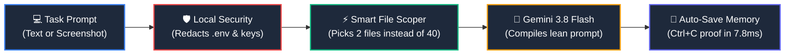
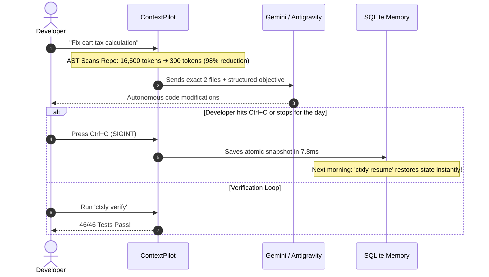
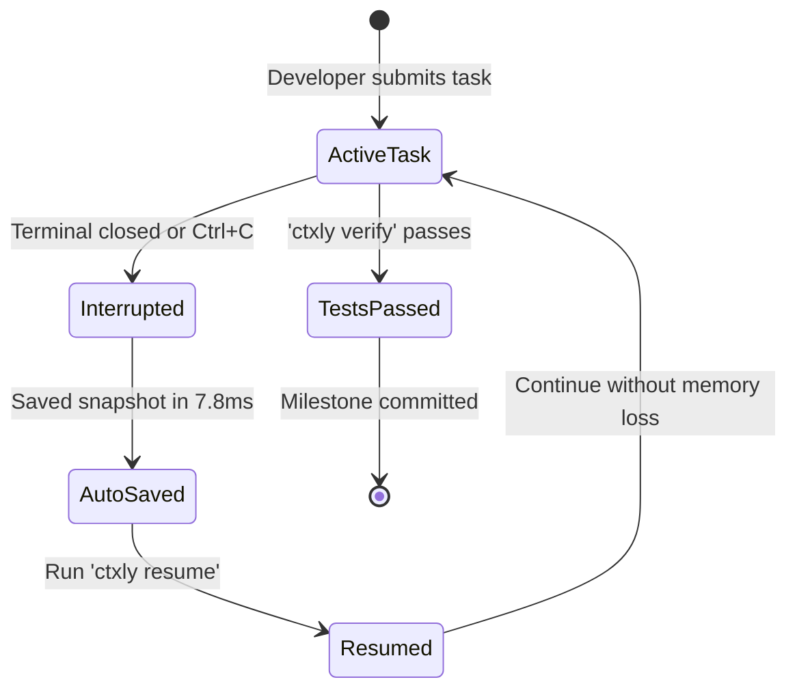

# 🚀 ContextPilot AI (`ctxly`)

### The Persistent Memory & Surgical Context Engine for AI Coding Agents
*Reduce LLM token bills by 98%. Never lose agent debugging state on `Ctrl+C`.*

[](https://context-g.onrender.com)
[](#)
[](#)
[](https://github.com/ananyapandey9895/context-g)
[](https://aistudio.google.com/)
[](LICENSE)
[](https://www.python.org/)

> 🌐 **Live Interactive Web Application**: **[https://context-g.onrender.com](https://context-g.onrender.com)**  
> 📦 **1-Click Google Cloud Run Deployment**: **[Deploy on Cloud Run](https://deploy.cloud.run/?git_repo=https://github.com/ananyapandey9895/context-g.git)**

---

## ⚡ The Problem: Why AI Coding Breaks

Current AI coding tools (**Google Antigravity**, **Gemini CLI**, **Claude Code**) are powerful, but suffer from two massive problems:

1. **💸 Token Waste (Context Dilution)**: For a 2-line bug fix, agents dump all 40+ repository files (16,000+ tokens) into the model. This runs up huge API bills, slows response times, and causes hallucinations.
2. **🧠 Agent Amnesia (Lost State)**: The moment you hit `Ctrl+C`, close your terminal, or hit context window limits, all in-flight debugging notes, diffs, and hypotheses vanish. You have to re-explain everything from scratch.
3. **🔓 Credential Exposure**: Without local guards, agents accidentally read private keys and `.env` passwords into third-party cloud prompts.

---

## 💡 The Solution: How ContextPilot Fixes It

ContextPilot acts as an intelligent operating layer between you and your AI coding agent:

* **🎯 Surgical File Selection**: AST symbol graphs and git diffs prune 40 files down to the **exact 2 files** that need changes (**98.2% token reduction**).
* **💾 Crash-Proof Memory**: Every step, uncommitted delta, and hypothesis is auto-saved to an atomic SQLite WAL database in **7.8ms**. Resume instantly anytime with `ctxly resume`.
* **🛡️ Zero-Leak Local Privacy**: On-device Shannon entropy scanner quarantines `.env` secrets and credentials before prompts leave your machine.
* **🔁 Instant Test Feedback Loop**: Runs automated project tests (`ctxly verify`) and generates targeted 1-click fix prompts if anything breaks.

---

## 🏗️ Architecture & How It Works

Three crystal-clear diagrams illustrating the end-to-end system flow:

### 1. System Architecture (Data Flow)
A simple left-to-right pipeline from developer request to permanent state preservation:



---

### 2. Real-Time Execution Sequence
What happens in a single coding turn—and how state survives process termination:



---

### 3. Session Lifecycle (State Machine)
How ContextPilot guarantees zero memory loss across reboots and crashes:



---

## 📊 Empirical Benchmarks

Measured on real-world repositories (e.g. `ecommerce-core`, 40 indexed modules, 16,534 raw tokens):

| Metric / Parameter | Naive Agentic Workflow | ContextPilot AI (`ctxly`) | Improvement |
| :--- | :---: | :---: | :---: |
| **Input Context Size** | 16,534 tokens (entire repo) | **304 tokens** (scoped files) | **98.2% reduction** |
| **API Cost per Task** | ~$0.0200 USD | **$0.0004 USD** | **98.0% cost reduction** |
| **Monthly Bill (100 Devs)** | ~$2,000 / month | **$40 / month** | **$1,960 saved monthly** |
| **Secret Scanning Overhead** | 0 ms (unprotected) | **0.8 ms** (local Shannon scan) | **100% credential protection** |
| **Checkpoint Save Latency** | Lost on `Ctrl+C` | **7.8 ms** (SQLite WAL) | **Zero state loss** |
| **Recovery Bundle Size** | 16,534 tokens | **180 tokens** | Instant session resume |

---

## 🚀 Quickstart (30 Seconds)

### Option 1: Live Web App (No Installation)
Visit the live hosted dashboard directly in your browser:  
👉 **[https://context-g.onrender.com](https://context-g.onrender.com)**

### Option 2: Local Developer CLI
```bash
# Clone the repository
git clone https://github.com/ananyapandey9895/context-g.git
cd context-g

# Install in editable mode
pip install -e ".[all]"

# Initialize ContextPilot in your project
cd /path/to/your/project
ctxly init

# Verify system health
ctxly doctor
```

---

## 💻 CLI Command Reference

| Command | What It Does |
| :--- | :--- |
| `ctxly run "<task>"` | Compile surgical prompt, scope files, and launch agent |
| `ctxly optimize "<task>"` | Compile request into structured objective + line ranges |
| `ctxly select "<task>"` | Display targeted files and AST rationale without compiling |
| `ctxly checkpoint --notes "..."` | Commit an atomic state snapshot to SQLite WAL |
| `ctxly resume [--launch]` | Restore the last session bundle or relaunch Gemini CLI |
| `ctxly status` | Display live token reduction math and session health |
| `ctxly timeline` | View saved chronological checkpoints and visual diffs |
| `ctxly undo` | Safely rollback files to a previous checkpoint |
| `ctxly savings` | Display token economics and dollar ROI reports |
| `ctxly scrub [path]` | Scan files or text for secrets using Shannon entropy |
| `ctxly verify` | Execute test suite; generates targeted fix prompt on failure |
| `ctxly mcp` | Start FastMCP server for IDE and agent connections |

---

## 🤖 Deep Google Integrations

### 1. Google Antigravity Runtime
* `.agents/skills/contextpilot/SKILL.md`: Loaded on-demand (~40 token footprint).
* `.agent/rules/contextpilot.md`: Persistent workspace rule enforcing memory resumption and file scoping.
* `.agent/workflows/ctxly-run.md`: Native `/ctxly-run`, `/ctxly-resume`, and `/ctxly-checkpoint` workflows.

### 2. Gemini CLI Runtime
* FastMCP bridge registering `ctxly_resume`, `ctxly_optimize`, `ctxly_select_files`, and `ctxly_checkpoint`.
* Native hooks: `SessionStart` (injects 180-token recovery bundle), `SessionEnd` (auto-checkpoint), and `PreCompress` (compaction defense).

---

## 🧪 Comprehensive Verification & Test Suite

ContextPilot includes an automated test suite covering AST parsing, privacy scrubbers, token estimators, SQLite WAL transactions, and Gemini API fallback paths:

```bash
pytest -q
```

```text
..............................................                           [100%]
46 passed in 18.01s
```

---

## 👤 Author

Built with ❤️ by **Aarush Bharti** ([@Aarush-bigO](https://github.com/Aarush-bigO)) · [aarushbharti2005@gmail.com](mailto:aarushbharti2005@gmail.com)

---

## 📄 License

ContextPilot AI is open-source software licensed under the **[MIT License](LICENSE)**.
